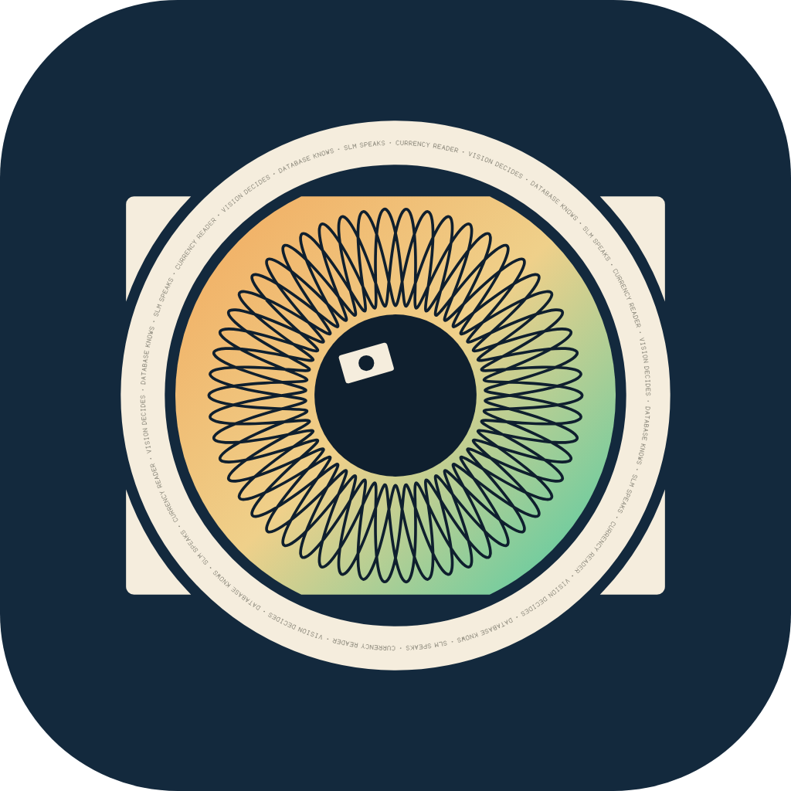

<p align="center">
  
</p>

<h1 align="center">Currency Reader</h1>

<p align="center">
  Point your phone at a banknote. Get the currency, the serial number and trustworthy facts about it, mostly on-device.
</p>

---

## What it is

Currency Reader is a Flutter app that identifies a banknote or coin from the camera, reads its serial number, and answers questions about it. Everything runs on the phone where possible: OCR, a small image classifier and a small language model. A self-hosted server supplies data updates and acts as a fallback.

**Guiding principle:** *vision decides, database knows, SLM speaks.*
The language model never "knows" currencies. It only rephrases facts retrieved from our own sourced database, and says "I don't have that information yet" when the facts don't cover the question.

## Status

Early development. The app opens on a working camera, but it cannot identify a currency yet.

| Done | Not started |
|---|---|
| Stage 0: tooling, repo layout, device log | Stage 2: currency database and lookup from the scanned text |
| Stage 1: live camera and on-device text reading (ML Kit), checked on an Android emulator only | Stages 3-11: on-device model, classifier, data packs, tiers, release |
| Flutter app architecture, light and dark UI, scan animation | `ml/` and `data/` (placeholders only) |
| Backend API with Swagger docs and error handling, on the branch `backend/api` (see [server/README.md](https://github.com/Karamkottish/Currency-reader/blob/backend/api/server/README.md)) | Connecting the app to the API |
| Logo and brand assets | |

The app opens straight on the camera, with an animated scan frame (searching, then locked) and a result sheet, in light and dark mode following the phone's setting. The camera and text reading are real. The shutter button still runs a demo scan that shows clearly labelled sample data, because nothing recognises a currency yet. Reading accuracy on real banknotes has not been tested: the emulator's camera has no text in view. A debug build shows what the text reader saw and how long it took.

## How it will work

1. **Scan:** the camera finds the note and a classifier says which note and side it is.
2. **Read:** the serial number is cropped, read with OCR, validated per currency, and confirmed by agreement across several frames. Unreadable serials are rejected, never guessed.
3. **Retrieve:** facts come from exact lookup, keyword search (SQLite FTS5) and vector search, merged with Reciprocal Rank Fusion.
4. **Answer:** a small on-device model streams an answer grounded only in the retrieved facts. Weak phones fall back to templated answers with no model.
5. **Update:** new currencies arrive as signed data packs, with no app release and no retraining.

## Repository layout

```
app/        Flutter app (feature-first: scan, identify, knowledge, chat, models_manager, tiering)
server/     NestJS backend, Postgres + pgvector, llama-server   (planned, Stage 7)
ml/         Python training and export for the models           (planned, Stage 4)
data/       Currency sources and the seed database builder      (planned, Stage 2)
docs/       Brand assets and the device benchmark log
```

Planning documents live at the repo root:

| File | Contents |
|---|---|
| [currency-app-roadmap.md](currency-app-roadmap.md) | The 12 stages, with steps, deliverables and exit checks |
| [flutter-currency-app-guide.md](flutter-currency-app-guide.md) | Flutter app guide |
| [flutter-structure-and-state.md](flutter-structure-and-state.md) | App folder structure and state management |
| [backend-structure-and-state.md](backend-structure-and-state.md) | Backend structure |

## Roadmap

| Stage | Name | Result |
|---|---|---|
| 0 | Preparation | Tools installed, devices ready, repo created |
| 1 | App shell, camera, OCR | Camera to text on screen |
| 2 | Data and retrieval, no model | Scan to facts from the database (templated answers) |
| 3 | On-device SLM spike | Streamed answers and measured speeds |
| 4 | Currency classifier | Reliable "which note is this" |
| 5 | Serial-number accuracy | Validated serials with multi-frame voting |
| 6 | RAG on device | Free-text questions answered from the facts |
| 7 | Backend | Postgres, NestJS and `llama-server` running |
| 8 | Data packs and updates | Add a currency without an app release |
| 9 | Tiers, hardening, performance | Works well on weak and strong phones |
| 10 | Custom OCR and embedding-based ID | Own trained recognizer, no retraining per currency |
| 11 | Release and scale | Store release, monitoring, growth |

## Getting started

**Requirements:** Flutter (stable), Android Studio with an Android SDK, and an emulator or a phone. Python 3.11+, Docker and Node 20+ are only needed from later stages.

```bash
cd app
flutter pub get
flutter analyze
flutter test
flutter run
```

Android is the development target on Windows. iOS builds need macOS (a Mac, or a CI service with Mac runners).

## Architecture in brief

- **Feature-first folders**, each with `presentation`, `domain` and `data` layers. Dependencies point inward, and the domain layer imports no Flutter or plugin code.
- **Riverpod** for state. Controllers depend on abstract providers, so tests swap in fakes.
- **One interface per engine** (`InferenceEngine`, `OcrEngine`, `Classifier`, `Retriever`), so a plugin can be replaced without touching features.
- **Heavy work stays off the UI isolate:** vision, OCR, embeddings and inference run in worker isolates.

Details are in [flutter-structure-and-state.md](flutter-structure-and-state.md).

## Logo

An engraved eye made from a lens ring over a banknote. The ring hides the note's edges and leaves its four corners showing, which forms `¤`, the sign for any currency. The thin line around the ring is microprint of the project's guiding principle. Files are in [docs/brand/logo/](docs/brand/logo/).

## Legal notes

- Rules on photographing and storing banknote images vary by country. Check them before collecting or publishing images.
- The app will not claim to detect counterfeits.
- Model and package licences are tracked in the roadmap's Stage 11 checklist. Verify each one before release.
